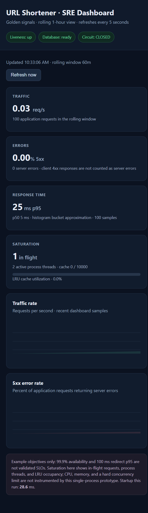

# Local HTTP smoke test

## Run details

- **Run time:** 2026-11-26 03:23:25 UTC
- **Target:** `GET http://127.0.0.1:8080/health`
- **Requests:** 100
- **Concurrency:** 10 workers
- **Result:** 100 HTTP 200 responses; 0 failures
- **Response body:** `{"status": "ok", "circuit": "CLOSED"}`
- **Elapsed wall time:** 0.6954 seconds

## Per-request latency

| Measure | Latency |
| --- | ---: |
| Minimum | 1.278 ms |
| Mean | 35.864 ms |
| p50 | 5.187 ms |
| p95 | 107.830 ms |
| Maximum | 531.535 ms |

This is a local smoke/load check of the liveness endpoint only. It does not measure
link creation, redirects, SQLite write throughput, or performance under external
network conditions. Latencies include local client and thread-scheduling overhead;
this run is not a production capacity benchmark.

The SRE dashboard's application traffic counters intentionally exclude `/health`
(along with other operational endpoints), so these 100 health checks do not appear
in its traffic/results cards. The dashboard now shows a rolling one-hour window;
the original test runs below were performed with the earlier 60-second setting.
The counters are implemented in
[`RequestMetrics.record_request`](../src/observability.py).

## Application traffic check

- **Run time:** 2026-11-26 03:28:32 UTC
- **Target:** `GET /dashboard-traffic-probe-{n}` (nonexistent short-code lookup)
- **Requests:** 100, with 10 concurrent workers
- **Result:** 100 HTTP 404 responses; expected for unknown codes
- **Elapsed wall time:** 0.795 seconds
- **Dashboard snapshot immediately after the run:** 100 requests in the rolling
  window, 1.667 requests/second, 0 server errors, and approximate p50/p95 latency
  of 5/25 ms

This second run uses an application route, so it appears in the dashboard's traffic
cards. Under the original 60-second setting, requests dropped from the count as
they aged out. The current one-hour window remains in process memory and resets
when the server restarts.

## Latest golden-signals run

- **Run time:** 2026-11-26 05:03:01 UTC
- **Target:** `GET /golden-signal-probe-{n}` (nonexistent short-code lookup)
- **Requests:** 100, with 10 concurrent workers
- **Result:** 100 HTTP 404 responses; expected for unknown codes
- **Elapsed wall time:** 0.751 seconds
- **Dashboard snapshot:** rolling 3600-second window, 100 requests, 0.028 req/s
  (displayed as 0.03 req/s), 0 server errors, approximate p50/p95 of 5/25 ms

## Dashboard screenshot

The screenshot below was refreshed after the latest run and is stored in the project at
[`metrics-dashboard.png`](./metrics-dashboard.png).

