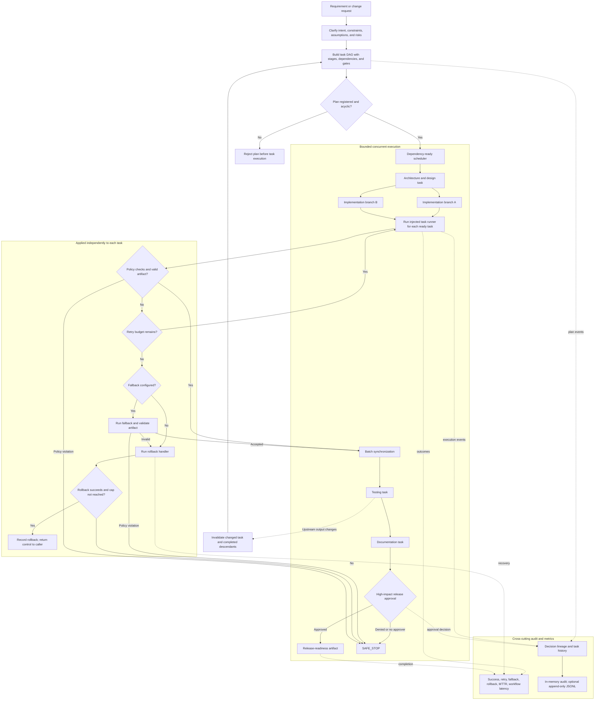

# Agentic SDLC Orchestration Flow

The diagram below describes how the orchestration engine executes the greenfield,
brownfield, and ambiguous-requirement scenarios. The scenario runners are
deterministic stand-ins; the engine accepts injected task runners.

Independent ready tasks receive the same context snapshot and are joined before
their dependents start. Replanning preserves prior history, invalidates affected
outputs, and requires invalidated tasks to pass their gates again. Approval is
fail-closed. JSONL audit output is optional and is not tamper-evident; orchestration
state is process-local.

For the URL shortener's create, redirect, and observability request paths, see
[`url-shortener-flow/url-shortener-flow.svg`](./url-shortener-flow/url-shortener-flow.svg).
